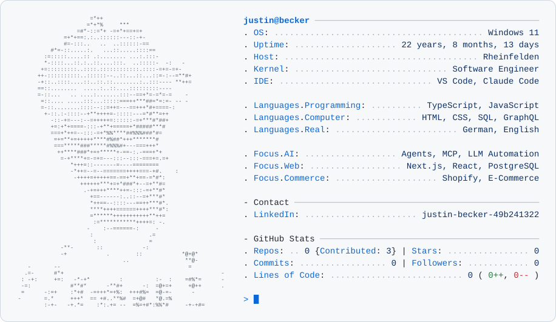

<!-- Generated by scripts/build.mjs from profile.config.json; edit those, not this file. -->

<picture>
  <source media="(prefers-color-scheme: dark)" srcset="assets/card-dark.svg">
  
</picture>

<a href="https://www.linkedin.com/in/justin-becker-49b241322/"><picture>
  <source media="(prefers-color-scheme: dark)" srcset="assets/button-0-dark.svg">
  
</picture></a>

<picture>
  <source media="(prefers-color-scheme: dark)" srcset="assets/contributions-dark.svg">
  
</picture>

